<div align="center">

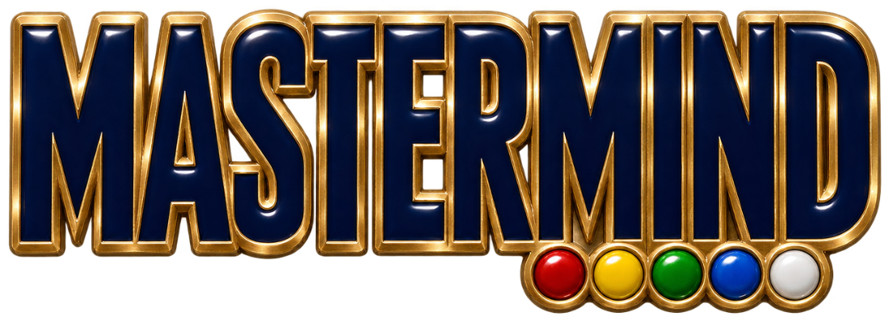

### The code-breaking classic on a walnut board, with a game server, a REST API and an MCP server so Claude can play against it remotely


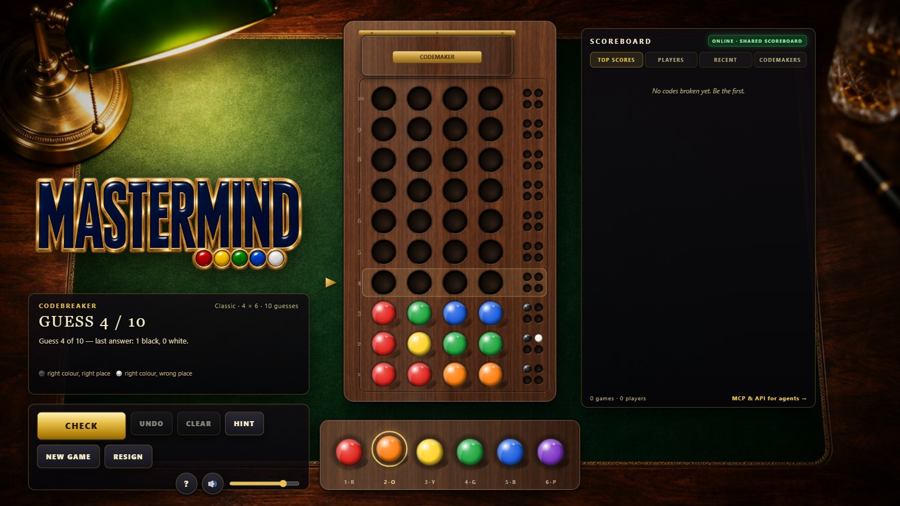

</div>

Plain HTML5 Canvas, Web Audio and vanilla JavaScript in the browser; one dependency-free
Node.js process behind it that serves the game, a REST API and a Model Context Protocol
server. You break the codemaker's code with as few guesses as possible, or set a code and
watch Knuth's solver break it. Every player, human or agent, plays on the same scoreboard.

> Unofficial recreation of the classic game for entertainment only. Play money, no wagering.

**Live table:** <https://cocojs.com/games/mastermind/> (shared scoreboard) · **MCP endpoint for agents:**
`https://cocojs.com/games/mastermind/mcp` · **Docs:** <https://cocojs.com/games/mastermind/docs/mcp.html>
· The GitHub Pages copy at <https://gextam.github.io/mastermind-web/> plays offline with a local scoreboard.

---

## Contents

1. [Features](#features)
2. [Platforms](#platforms)
3. [Installation](#installation)
4. [Let Claude play (MCP server & API)](#let-claude-play-mcp-server--api)
5. [Configuration reference](#configuration-reference)
6. [User guide](#user-guide)
7. [Keyboard shortcuts](#keyboard-shortcuts)
8. [Scoring](#scoring)
9. [Known limitations](#known-limitations)
10. [Project layout](#project-layout)
11. [Development](#development)

---

## Features

**The table**

* A walnut decoding board under a banker's lamp: drilled rows, routed channel, engraved
  row numbers, a 2×2 (or 3×2, 4×2) key-peg cluster per row, a brass hinged shield over
  the codemaker's row
* Glossy pre-rendered pegs that drop into their holes with a bounce; key pegs that pop in
  one by one; a brass marker that slides to the next row; the shield swings open on its
  hinge to reveal the code; confetti for a win, a shake for a loss
* Click, drag and drop, right-click to remove, full keyboard play

**The game**

* Both roles: **codebreaker** (the server hides a code) and **codemaker** (you hide a code,
  the server's Knuth minimax solver breaks it row by row while you watch)
* Six boards: Classic 4 pegs × 6 colours × 10 guesses, Mini, No repeats, With blanks,
  Super 5 × 8 × 12, Grand 6 × 8 × 15, plus custom rules (2–8 pegs, 2–10 colours, 1–30
  guesses, repeats and blanks on or off)
* Hints from the solver (how many codes are still possible, a sample, and its next guess
  placed on the board) at the price of one guess in the score
* Shared scoreboard: top scores, players, recent games, codemakers; resumes a game in
  progress after a reload; falls back to a local scoreboard when no server is reachable

**The server**

* REST API under `/api` and an **MCP server** at `/mcp` (Streamable HTTP, stateless) plus a
  stdio bridge for Claude Desktop; the same eight operations everywhere, generated from one
  tool catalog with one validator; resources, prompts and an OpenAPI 3.1 document
* Optional API key, origin policy for browser clients, per-address rate limit, atomic JSON
  persistence, base-path mounting behind a reverse proxy

**Sound (synthesized in Web Audio)**

* Plastic ticks and wooden knocks for the pegs, two-pitch clinks for black and white key
  pegs, the marker's slide, the shield's hinge creak and knock, win fanfare, loss sting,
  the solver's thinking ticks, a quiet study-room ambience with a clock

---

## Platforms

| Platform | Status | Notes |
| --- | --- | --- |
| Chrome / Edge (desktop) | Tested | Headless Chrome runs the smoke test and screenshots |
| Firefox (desktop) | Expected to work | Canvas 2D and Web Audio only |
| Safari (macOS / iOS) | Expected to work | Audio starts after the first tap |
| Static hosting / `file://` | Works offline | The game core runs in the browser with a local scoreboard; the server adds the shared scoreboard and the APIs |
| Server | Node.js 20+ | No packages to install |

---

## Installation

1. **Get the files** (keep `assets/`, `css/`, `js/`, `server/` next to `index.html`).
2. **Start the server:**

   ```bash
   node server/server.js
   ```

   or double-click `start.cmd` on Windows, then open <http://localhost:8772/>.
   The data file `server/data/state.json` is created on first use.
3. **Click once** on the splash to take a seat (this unlocks audio), pick a role and a board.
4. Without Node you can still serve the folder statically (`python -m http.server 8772`):
   the game then runs entirely in the browser with scores kept in `localStorage`.

Optional URL parameters: `?mute=1` starts silent, `?local=1` forces the in-browser game,
`?player=Name` presets the name.

---

## Let Claude play (MCP server & API)

The server speaks the Model Context Protocol. Connect any MCP client and ask for a game:

```bash
# Claude Code — the live table (remote, Streamable HTTP)
claude mcp add --transport http mastermind https://cocojs.com/games/mastermind/mcp

# Claude Code — your own server
claude mcp add --transport http mastermind http://localhost:8772/mcp

# Claude Desktop — stdio bridge (claude_desktop_config.json)
{ "mcpServers": { "mastermind": { "command": "node", "args": ["/path/to/mastermind/server/mcp-stdio.js", "--url", "http://localhost:8772/mcp"] } } }

# claude.ai — Settings → Connectors → Add custom connector → http://your-host/mcp
```

> “Play a game of Mastermind as *Claude* on the classic board. Read the rules first,
> keep track of which codes are still possible after every answer, and tell me the
> secret, your guess count, your score and your rank when you are done.”

| Tool | What it does | REST |
| --- | --- | --- |
| `rules` | Notation, boards, feedback rules, scoring, strategy | `GET /api/rules` |
| `new_game` | Start a game (codebreaker by default; `mode: "maker"` + `secret` for codemaker) | `POST /api/games` |
| `guess` | Submit a code, get black/white feedback and the state | `POST /api/games/{id}/guess` |
| `get_game` | Full state of a game (secret and score once finished) | `GET /api/games/{id}` |
| `list_games` | Games in progress, by player or status | `GET /api/games` |
| `hint` | Remaining consistent codes, a sample, the solver's next guess (costs a guess) | `POST /api/games/{id}/hint` |
| `resign` | Give up, reveal the code | `POST /api/games/{id}/resign` |
| `get_scores` | Top scores, codemakers, player statistics, recent games | `GET /api/scores` |

Also: resources `mastermind://rules`, `mastermind://scores`, `mastermind://games/{id}`;
prompts `play` and `strategy`; `GET /api/tools` and `GET /api/openapi.json`.

**Full documentation:** [docs/mcp.html](docs/mcp.html) (also served at `/docs/mcp.html`)
covers every tool with real example requests and responses, the REST reference and error
codes, scoring, an agent playbook, server options, authentication, reverse-proxy mounting
and protocol notes. `node tools/play-demo.js` plays a game through the MCP endpoint from
the command line so you can watch the transcript.

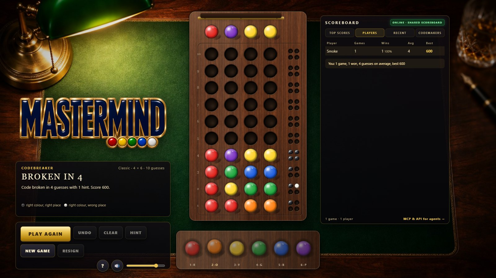

---

## Configuration reference

| Setting | Where | Default | Meaning |
| --- | --- | --- | --- |
| `--port`, `--host` | server CLI / `PORT`, `HOST` | `8772`, `0.0.0.0` | Listening address |
| `--data` | server CLI / `MASTERMIND_DATA` | `server/data/state.json` | Persistence file (live games + records) |
| `--api-key` | server CLI / `MASTERMIND_API_KEY` | none | Require `Authorization: Bearer` on `/mcp` and game routes |
| `--allowed-origins` | server CLI / `MASTERMIND_ALLOWED_ORIGINS` | same host + localhost | Extra browser origins allowed on `/mcp` |
| `--base-path` | server CLI / `MASTERMIND_BASE_PATH` | `` | Prefix to strip when mounted behind a proxy |
| `--public-url` | server CLI / `MASTERMIND_PUBLIC_URL` | `` | External address advertised in `/api/tools` and OpenAPI |
| `--no-static`, `--quiet` | server CLI | off | Serve only the APIs; no access log |
| `PRESETS`, `LIMITS`, `PALETTE` | `js/engine.js` | six boards, 2–8 pegs, 10 colours | Boards, bounds and colours (shared by browser and server) |
| `MAX_ENUM` | `js/engine.js` | `2,000,000` | Largest code space the solver enumerates (hints, codemaker mode) |
| `LAYOUT`, `TIMING` | `js/config.js` | board geometry, 0.28 s drop, 1.35 s solver step | Scene layout and animation pacing |
| `mastermind.volume`, `mastermind.muted` | browser `localStorage` | `0.8`, `0` | Remembered volume and mute |

---

## User guide

### New game

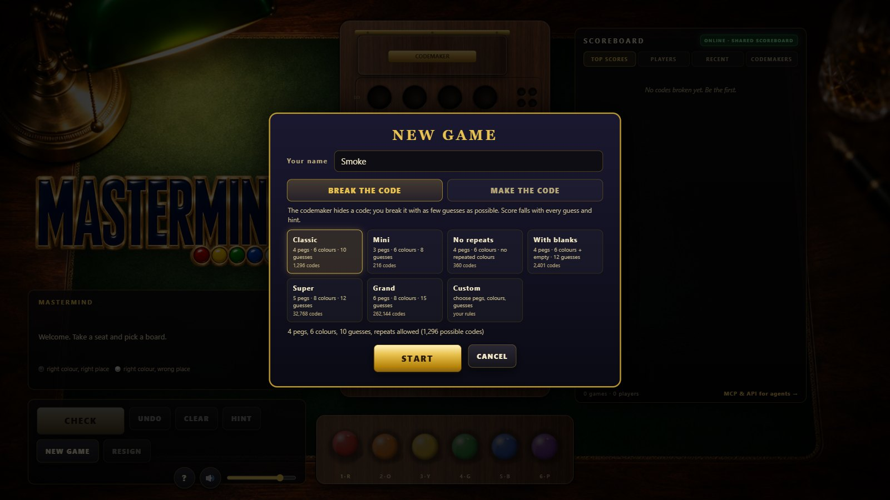

Type a name for the scoreboard, choose **Break the code** or **Make the code**, pick a
board or set custom rules. The note under the boards tells you how many codes are possible.

### Breaking the code

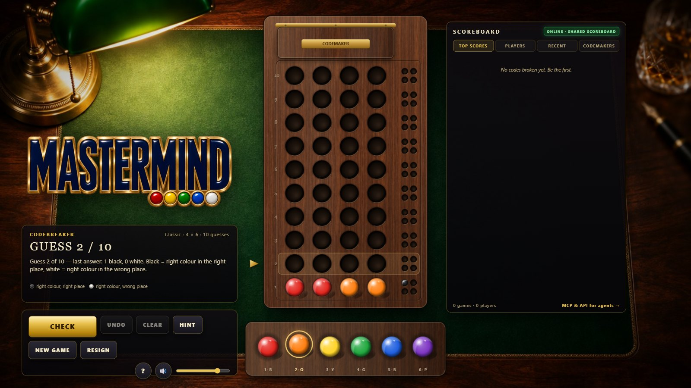

Click a colour in the tray to fill the next hole (or click a hole directly, or drag a peg
onto it), then press **CHECK**. The key pegs answer: **black** for a peg of the right colour
in the right place, **white** for the right colour in the wrong place. They are counts, not
positions. The brass marker moves up to the next row.

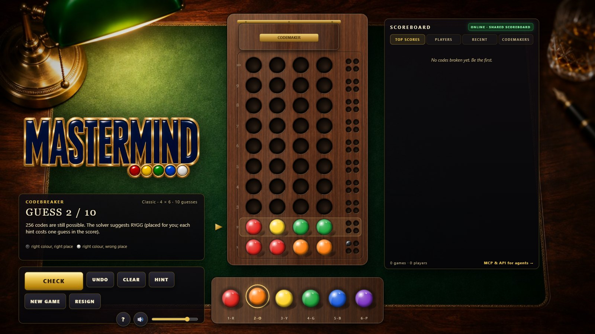

**HINT** asks the solver how many codes are still consistent with every answer so far and
places its suggested guess on the board. You may change it before checking. Each hint costs
one guess in the score.

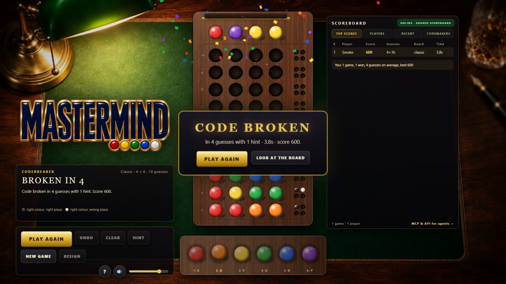

When your guess is all black the shield swings open to reveal the code, confetti falls, the
banner shows your guesses, time and score, and the scoreboard updates. Run out of guesses
and the shield opens anyway.

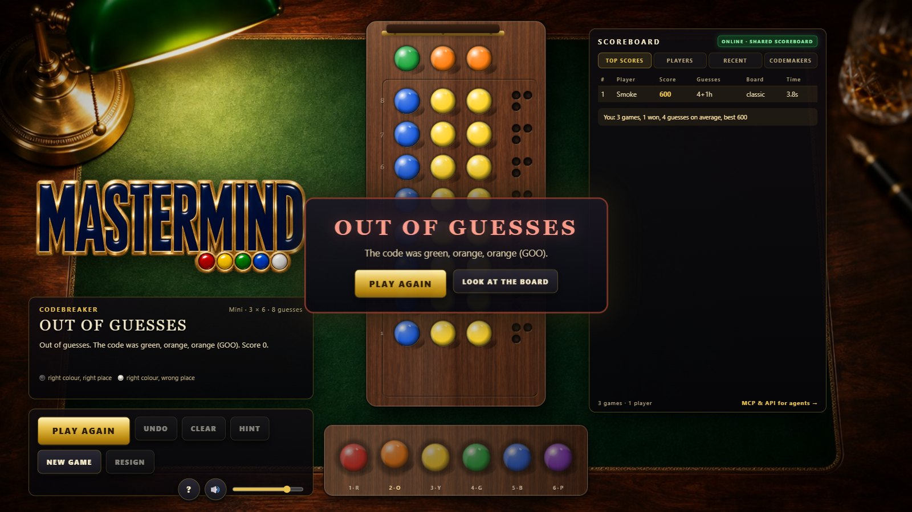

### Making the code

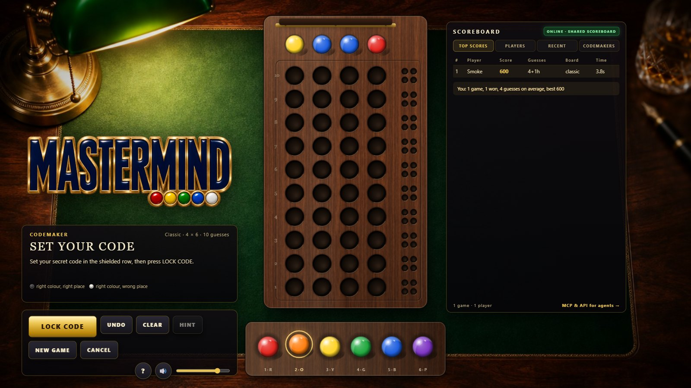

In codemaker mode the shield starts open: place your secret in the top row and press
**LOCK CODE**. The shield closes and the server's solver starts guessing.

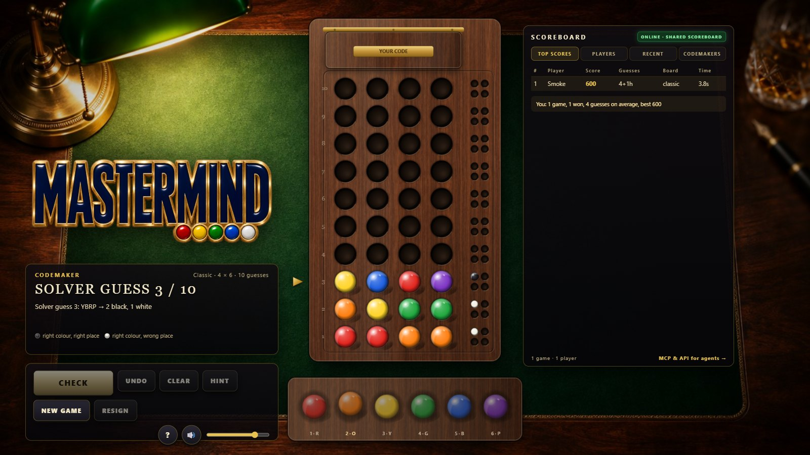

Rows appear one by one with their feedback. When the solver has the code the shield opens
and your codemaker points (the guesses it needed) go on the **CODEMAKERS** tab.

### Scoreboard and help


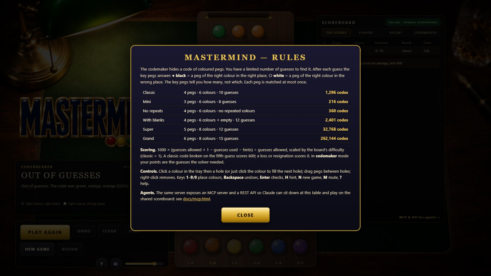

The badge at the top of the scoreboard says whether you are online (shared scoreboard,
agents included) or offline (local scores on this device).

---

## Keyboard shortcuts

| Key | Action |
| --- | --- |
| `1` – `9`, `0` | Select a colour and fill the next hole (`0` = empty when blanks are on, or the tenth colour) |
| `←` / `→` | Change the selected colour |
| `Enter` / `Space` | Check the guess, lock the code, or start a new game after a result |
| `Backspace` | Undo the last peg |
| `Delete` | Clear the row |
| `H` | Hint |
| `N` | New game |
| `M` | Mute / unmute |
| `?` / `F1` | Help |
| `Esc` | Close dialogs |
| right-click | Remove a peg |

---

## Scoring

**Codebreaker:** `score = round(1000 × (max_guesses + 1 − guesses_used − hints_used) ÷ max_guesses × difficulty)`,
with `difficulty = ln(code_space) ÷ ln(1296)` (classic = 1.00, Super ≈ 1.45, Grand ≈ 1.74).
A classic code broken on the first guess scores 1000, on the fifth 600, on the tenth 100.
Lost or resigned games score 0.

**Codemaker:** points = guesses the solver needed (+1 if it never broke the code). Knuth's
minimax never needs more than five on the classic board, so 5 is a perfect code there.

---

## Known limitations

* The solver enumerates the code space; boards with more than 2,000,000 codes (for example
  8 pegs × 10 colours) can be played as codebreaker but offer no hints or codemaker mode.
* Game ids are the only handle: anyone who knows an id can play that game. Ids are random
  12-character strings and games expire after 24 hours of inactivity.
* The scoreboard is per server; a static deployment keeps scores only in the browser.
* Single-player against the server; there is no live two-human mode.

---

## Project layout

```
mastermind/
├── index.html            canvas scene + status, controls, scoreboard, dialogs, splash
├── start.cmd             Windows launcher (starts the server, opens the browser)
├── package.json          scripts: start · mcp · test · smoke · docs · demo (no dependencies)
├── css/style.css         HUD styling
├── js/
│   ├── engine.js         rules, feedback, code space, Knuth solver, parsing, scoring (shared with the server)
│   ├── core.js           game lifecycle, JSON views, records, leaderboard (shared with the server)
│   ├── config.js         stage layout, animation timing, storage keys
│   ├── audio.js          shared Web Audio synthesizer engine
│   ├── audio-mm.js       pegs, key pegs, shield, fanfares, ambience
│   ├── assets.js         image loading, pre-rendered peg / key / hole sprites
│   ├── client.js         API client with in-browser fallback (local scoreboard)
│   ├── game.js           state machine, animation timeline, both roles
│   ├── renderer.js       table, board, shield, rows, tray, marker, particles
│   ├── ui.js             DOM: dialogs, scoreboard, pointer + keyboard handling
│   └── main.js           bootstrap, frame loop, test hooks (MM.step)
├── server/
│   ├── server.js         HTTP: static files, REST under /api, MCP at /mcp (Streamable HTTP)
│   ├── mcp-stdio.js      MCP over stdio: bridge to a server, or in-process with --local
│   ├── mcp.js            JSON-RPC dispatcher: initialize, tools, resources, prompts
│   ├── tools.js          the tool catalog, argument validation, OpenAPI generation
│   ├── service.js        game operations (new, guess, hint, resign, scores)
│   ├── store.js          atomic, debounced JSON persistence
│   └── data/             state.json (created at runtime, git-ignored)
├── assets/               bg/table.jpg, walnut.jpg, logo.png
├── docs/                 landing page, mcp.html (generated), openapi.json (generated), screenshots/
└── tools/
    ├── test-engine.js    rules, parsing, scoring, solver sweep (every classic code in ≤ 5), core, leaderboard
    ├── test-api.js       REST + MCP end-to-end, stdio bridge, API key, rate limit
    ├── screenshots.mjs   headless smoke test driving whole games through the UI + screenshots
    ├── gen-docs.mjs      generates docs/mcp.html and docs/openapi.json from the catalog
    ├── play-demo.js      an agent playing through the MCP endpoint (transcript)
    ├── mcp-client.js     minimal Streamable HTTP MCP client used by tests and the demo
    ├── headless.mjs      Chrome/CDP helpers shared by the tools
    ├── prep-assets.mjs   trims the logo and re-encodes the generated art
    └── deploy.sh         tar-over-ssh upload + service restart
├── deploy/               mastermind.service, apache-mastermind.conf, README.md (server setup)
```

---

## Development

**Run locally:** `node server/server.js` and open <http://localhost:8772/>. The server logs
every request; `--quiet` silences it.

**Test hooks:** `?mute=1`, `?local=1`, `?player=Name`. In the console, `MM.step(seconds)`
advances the animation clock deterministically, `MM.game` is the state machine
(`MM.game.start({ mode: 'breaker', config: { preset: 'classic' } })`, `place(col, colour)`,
`submit()`, `hint()`), `MM.client` talks to the API, `MM.ui.scores` holds the scoreboard.

**Tests:**

```bash
node tools/test-engine.js     # 79 checks: feedback rules, parsing, scoring, core, leaderboard,
                              # and Knuth's solver over all 1296 classic codes (max 5 guesses)
node tools/test-api.js        # 84 checks: REST, MCP (initialize, tools, resources, prompts,
                              # batches, SSE, origin, errors), an agent winning via MCP,
                              # the stdio bridge in both modes, API key, rate limit
node tools/screenshots.mjs    # headless Chrome: whole games through the UI against the real
                              # server, codemaker mode, a loss, offline fallback; writes docs/screenshots
node tools/gen-docs.mjs       # regenerate docs/mcp.html + docs/openapi.json
node tools/play-demo.js       # watch an agent play through the MCP endpoint
```

**Publish:** enable GitHub Pages for the repository root for the static game (`/`) and the
landing page (`/docs/`): that copy plays offline with a local scoreboard.

**Put it on the internet:** `tools/deploy.sh` streams the project to a server over SSH and restarts
its systemd unit (`DEPLOY_HOST=… DEPLOY_DIR=… DEPLOY_OWNER=… tools/deploy.sh`); `deploy/` holds the
unit file, the Apache rules for mounting under `/games/mastermind` and the step-by-step notes. The live
table at cocojs.com runs exactly that way: Node 22 as a systemd service on 127.0.0.1:8772 with
`--base-path /games/mastermind`, proxied by Apache.
